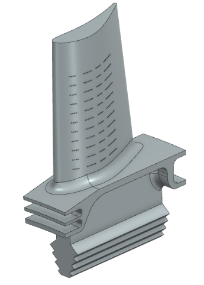
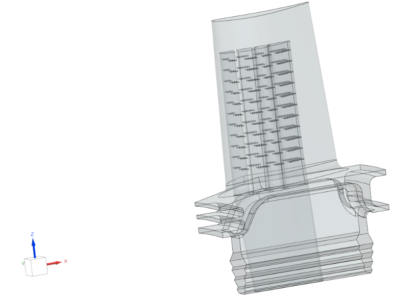

# Third-Stage Turbine Blade – Reverse Engineering

## Project Overview

This project involved reverse engineering a third-stage turbine blade and reconstructing its geometry in Siemens NX.

The first step was to obtain the airfoil geometry of the physical blade using CT scanning technology. The scanning process allowed me to obtain dimensional information describing the airfoil profile across an XYZ coordinate system.

I then used these measurements as a starting point for reconstructing the airfoil sections. For the remaining features of the blade, including the platform and fir-tree attachment root, I referred to turbine blade profiles and technical material that I had previously studied during my aircraft maintenance training in Egypt, particularly material relating to CFM and GE engines.

Since complete dimensional information was not available for every feature, I had to examine the available profiles, interpret the geometry and estimate certain dimensions in order to complete the reconstruction.

Another part of the project involved developing a Python program in PyCharm to process the airfoil coordinate data and generate the files required to import the profiles into Siemens NX.

## Final CAD Model

The final model includes the reconstructed airfoil, platform and fir-tree attachment root.

## Airfoil Contours

The airfoil geometry was obtained using CT scanning, which provided three-dimensional coordinate information describing the profile.

Using the acquired measurements, I established five airfoil sections at different heights along the blade.

The coordinate data was organised into X values and corresponding Y values for the convex and concave surfaces. The Z-heights defined the position of each section along the blade.

I then used Python to process the coordinate data and generate separate DAT files for the two surfaces of each section. These profiles were subsequently imported into Siemens NX and used to reconstruct the blade geometry.

## Internal Cooling Passages

The following image shows the blade in a transparent view, making the internal cooling passages visible.

## Geometric Reconstruction of the Remaining Features

While CT scanning was used to obtain the airfoil dimensions, the remaining blade features required a different approach.

I referred to turbine blade profiles and technical material studied during my aircraft maintenance training in Egypt to understand the general configuration of the platform, attachment root and other geometric features.

Where specific dimensions were unavailable, I used engineering judgement and estimated dimensions based on the available reference material and the overall blade geometry.

## Python - Airfoil Coordinate Processing

One of the main parts of this project was writing a Python program in PyCharm to automate the processing of the airfoil coordinate data.

The input data was organised in an Excel workbook containing the X-coordinate values and corresponding Y-coordinate values for the convex and concave surfaces. The Z-heights of the individual airfoil sections were also established from the geometric measurements.

I developed the Python program to read and process the coordinate data, separate the two surfaces and generate individual DAT files for import into Siemens NX.

The program generated a total of 10 DAT files, representing the convex and concave surfaces across the five airfoil sections.

This made it easier to transfer the sectional geometry into Siemens NX without having to prepare each coordinate file manually.

The Python source code is available in the `Aerofoil-Data-Parsing` folder.

## Siemens NX - CAD Reconstruction

After generating the DAT files, I imported the airfoil coordinates into Siemens NX and reconstructed the individual profiles at their corresponding Z-heights.

I then used the five sections to develop the three-dimensional blade geometry, before completing the remaining features, including the platform and fir-tree attachment root.

The final model was saved as a native Siemens NX part file.

## Project Workflow

1. Use CT scanning to obtain the three-dimensional XYZ coordinates of the airfoil geometry.
2. Interpret the airfoil measurements and establish five sectional profiles.
3. Refer to turbine blade profiles and technical material to reconstruct the remaining blade features.
4. Organise the airfoil coordinate data in Excel.
5. Develop a Python program to process the coordinates and generate 10 DAT files.
6. Import the generated profiles into Siemens NX.
7. Reconstruct the airfoil and develop the complete three-dimensional CAD model.
