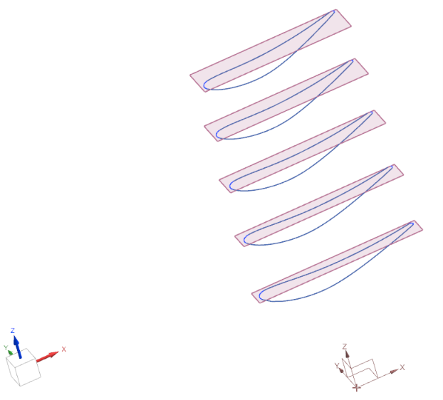

# Third-Stage Turbine Blade - Reverse Engineering

## Project Overview

This project involved reverse engineering a third-stage turbine blade and reconstructing its geometry in Siemens NX.

I started by using CT scanning technology to obtain the dimensions of the airfoil and examine the internal cooling passages. The CT scanning process provided three-dimensional geometric information using an XYZ coordinate system, which I used as a reference for reconstructing the blade.

I also used conventional manual inspection of the physical blade to identify the locations and arrangement of the film-cooling holes. This helped me understand how these features were positioned and allowed me to incorporate approximate representations into the CAD model.

For the airfoil, I used the acquired coordinate measurements to establish five sections at different heights along the blade. For the remaining external features, including the platform and fir-tree attachment root, I referred to turbine blade profiles and technical material that I had previously studied during my aircraft maintenance training in Egypt, particularly material relating to CFM and GE engines.

The internal cooling passages were also reconstructed using the CT-derived geometric information. However, some of the dimensions had to be adjusted approximately to reproduce the general features of the internal cooling system.

Since complete dimensional information was not available for every feature, I had to interpret the available measurements, examine the geometry and estimate certain dimensions to complete the reconstruction.

Another part of the project involved developing a Python program in PyCharm to process the airfoil coordinate data and generate the files required to import the profiles into Siemens NX.

## Final CAD Model

The final model includes the reconstructed airfoil, platform and fir-tree attachment root, together with representations of the internal cooling features.

## Airfoil Contours

The airfoil geometry was obtained using CT scanning, which provided three-dimensional coordinate information describing the profile.

Using the acquired measurements, I established five airfoil sections at different heights along the blade.

The coordinate data was organised into X values and corresponding Y values for the convex and concave surfaces. The Z-heights defined the position of each section along the blade.

I then used Python to process the coordinate data and generate separate DAT files for the two surfaces of each section. These profiles were subsequently imported into Siemens NX and used to reconstruct the blade geometry.

The following image shows the airfoil contours generated from the coordinate data.

## Internal Cooling Passages

The internal cooling passages were also examined using CT scanning technology. The acquired geometric information was used as a reference for reconstructing the internal cooling features in Siemens NX.

Some dimensions had to be adjusted approximately to reproduce the general layout and geometry of the cooling passages, as complete dimensional information was not available.

For the film-cooling holes, I used conventional manual inspection of the physical blade to identify their locations and understand their arrangement. This provided additional information that helped me reproduce the holes and their general positioning in the CAD model.

The following image shows the blade in a transparent view, making the reconstructed internal cooling features visible.

## Geometric Reconstruction of the Remaining Features

While CT scanning provided the geometric information for the airfoil and internal cooling features, the remaining blade geometry required additional interpretation.

I referred to turbine blade profiles and technical material studied during my aircraft maintenance training in Egypt to understand the general configuration of the platform, attachment root and other external features.

Where specific dimensions were unavailable, I used engineering judgement and estimated dimensions based on the available reference material and the overall blade geometry.

## Python - Airfoil Coordinate Processing

One of the main parts of this project was writing a Python program in PyCharm to automate the processing of the airfoil coordinate data.

The input data was organised in an Excel workbook containing the X-coordinate values and corresponding Y-coordinate values for the convex and concave surfaces. The Z-heights of the individual airfoil sections were established from the available geometric information.

I developed the Python program to read and process the coordinate data, separate the two surfaces and generate individual DAT files for import into Siemens NX.

The program generated a total of 10 DAT files, representing the convex and concave surfaces across the five airfoil sections.

This made it easier to transfer the sectional geometry into Siemens NX without having to prepare each coordinate file manually.

The Python source code is available in the `Aerofoil-Data-Parsing` folder.

## Siemens NX - CAD Reconstruction

After generating the DAT files, I imported the airfoil (X, Y, Z) coordinates into Siemens NX using the Spline Feature, and reconstructed the individual profiles at their corresponding Z-heights, to close the leading and trailing edge arcs.

I then used the five sections to develop the three-dimensional blade surface geometry using the Through Curves Feature, before completing the remaining features, including the platform, fir-tree attachment root and internal cooling features.

The final model was saved as a native Siemens NX part file.

## Project Workflow

1. Use CT scanning to obtain three-dimensional geometric information for the airfoil and internal cooling passages.
2. Extract and interpret the airfoil coordinates using an XYZ coordinate system.
3. Establish five airfoil sections at their respective blade heights.
4. Examine the physical blade manually to identify the locations and arrangement of the film-cooling holes.
5. Refer to turbine blade profiles and technical material to reconstruct the remaining external features.
6. Organise the airfoil coordinate data in Excel.
7. Develop a Python program to process the coordinates and generate 10 DAT files.
8. Import the generated profiles into Siemens NX.
9. Reconstruct the airfoil and complete the three-dimensional CAD model, including the internal cooling features.

## Software and Tools

- **Siemens NX:** Three-dimensional CAD modelling and surface reconstruction.
- **Python:** Coordinate processing and automated DAT file generation.
- **PyCharm:** Python development environment.
- **Microsoft Excel:** Organisation of airfoil coordinate data.
- **CT Scanning:** Geometric examination of the airfoil and internal cooling passages.
- **Manual Inspection:** Identification of film-cooling hole locations and arrangement.

## Skills Demonstrated

**Reverse Engineering and Geometric Inspection**
- CT-assisted geometric examination.
- Three-dimensional coordinate interpretation.
- Internal cooling passage reconstruction.
- Manual inspection of physical components.
- Engineering judgement and dimensional estimation.

**Aerospace Engineering**
- Gas turbine blade geometry.
- Airfoil sectional profiles.
- Internal cooling features and film-cooling holes.
- Platform and fir-tree attachment geometry.
- Interpretation of turbine blade reference material.

**CAD Modelling**
- Siemens NX.
- Airfoil profile reconstruction.
- Section-based modelling.
- Three-dimensional surface construction.
- Internal feature modelling.

**Programming and Data Processing**
- Python programming.
- Coordinate data parsing.
- Data organisation and transformation.
- Automated DAT file generation.
- Integration of Python workflows with CAD software.

## Project Scope and Limitations

The final model is an engineering reconstruction based on CT-derived geometric information, manual inspection, reference material and estimated dimensions where complete information was unavailable.

Some internal cooling dimensions and film-cooling hole features were approximated to reproduce their general geometry and arrangement.

The model is intended to demonstrate the reverse-engineering and CAD modelling process rather than represent a dimensionally certified reproduction of an original production component.

No aerodynamic, structural or manufacturing validation has been performed.

---

**Project:** Third-Stage Turbine Blade Reverse Engineering

**CAD Software:** Siemens NX

**Programming Language:** Python

**Development Environment:** PyCharm

**Data Organisation:** Microsoft Excel
